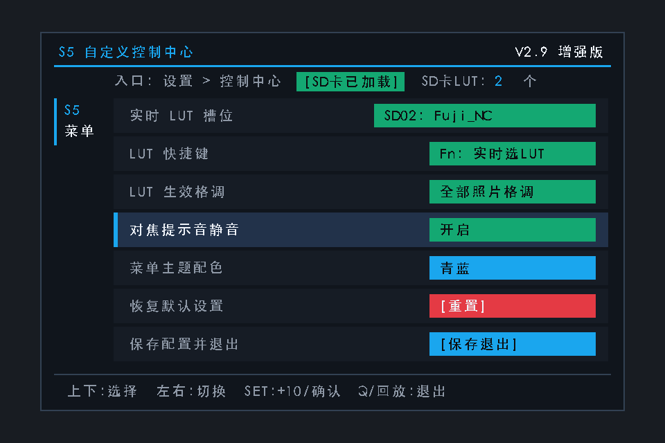
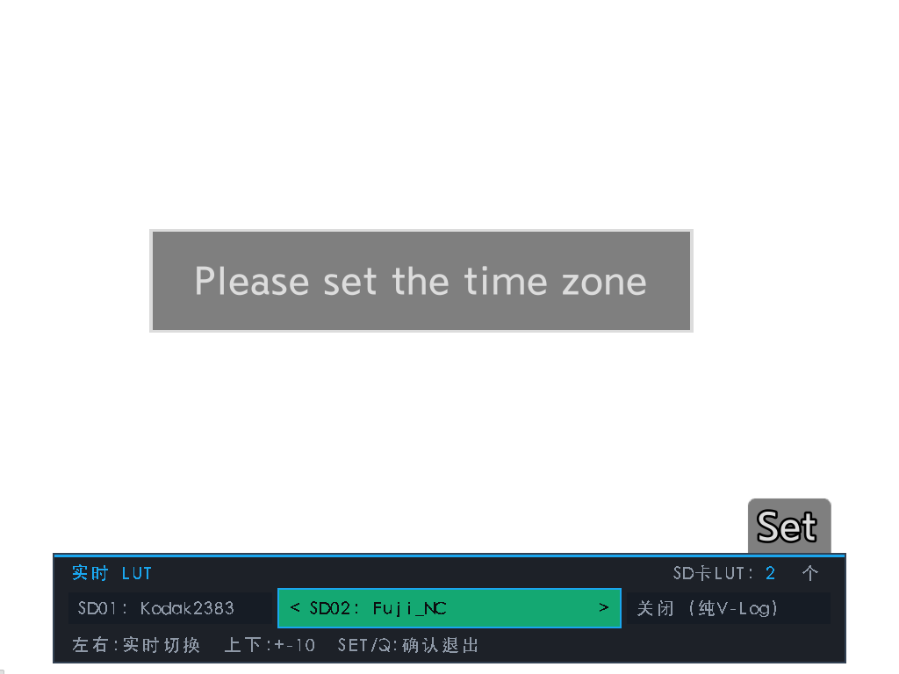

# Panasonic Lumix DC-S5 (V2.9 / MC801) 增强定制固件

面向松下 Lumix DC-S5 一代（固件 V2.9，`MC801`）的全功能定制增强固件工程，集成 **无时长限制高规格录制解锁**、**S5II 风格底部实时 LUT 快捷切换条**、**独立中文 OpenVG 自定义控制中心**、**SD 卡 100 个 `.CUBE` / `.VLT` 直读解析** 与 **极速 Direct-YCbCr 照片实时 LUT 直出**。






---

## 一、核心特性总览

1. **S5II 风格实时 LUT 快捷条 & 100 个 SD 卡 LUT 扩展（`03_program.bin` @ `0x07100000`）**
   - **一键呼出不挡取景**：接管原厂 `Fn → LUT 选择`（`0x0686A074`），按下绑定的 Fn 键即在取景画面底部弹出 `122px` 三卡片式转盘（`< SD02: Fuji_NC >`），保留上方 80% 实时取景视野；左右键实时切换，上下键 `±10` 快速翻页，再按一次 Fn 或 `SET` / `Q` 即收起。
   - **突破原厂 4 槽限制，支持 100 个 `.CUBE` / `.VLT`**：
     - **清单模式**：读取 `A:\LUT\LIST.TXT`（自动回退 `B:\LUT\LIST.TXT`），支持最多 100 个最长 43 字符的自定义文件名（兼容 UTF-8 BOM、行尾空白、`#` 注释）。
     - **零配置模式**：无 `LIST.TXT` 时自动扫描 `A:\LUT\001.CUBE`..`100.CUBE` 或 `001.VLT`..`100.VLT`，并自动提取 `TITLE "..."` 作为显示名。
     - **流式整数解析（零 FPU）**：兼容 `9³ / 17³ / 33³ / 65³` `.CUBE`（含 `LUT_1D_SIZE` 预曲线跳过、无尾换行冲洗）与 `17³` `0..4095` `.VLT`，实时重排进 `0x0710A200` 的 `0xBEEF` 八分体缓冲并同步刷新取景器/HDMI ISP 硬件 3D-LUT。
   - **全格调实时监看与所见即所得**：钩住 `0x066AE7C4` 并持久同步 `0x08CC576B/C`，在 `V-Log (0x0A/0x0B)`、`自定义照片格调 1..10 (0x1E..0x27)` 及“全部照片格调”模式下，屏幕取景与最终 JPEG 直出严格一致，半按快门不掉 LUT；切回 `关闭 (纯V-Log)` 时同时关闭监看与直出烘焙。

2. **独立中文 OpenVG 控制中心（`MENU → 设置 → 其他 → 控制中心`）**
   - `20_osdover.bin` 原位等字节替换 `像素更新` → `控制中心`（英文 `Pixel Refresh` → `ControlCenter`），点击即打开 7 行中文面板：
     1. `实时 LUT 槽位`（`关闭 (纯V-Log)` / 已导入机内槽位 / `SD01..SD100`）
     2. `LUT 快捷键`（`Fn: 实时选LUT` / `Fn: 打开面板` / `关闭 (原厂)`）
     3. `LUT 生效格调`（`仅V-Log/自定` / `全部照片格调`）
     4. `对焦提示音静音`（实时清零/恢复 `0x06E35134` 对焦滴声采样数）
     5. `菜单主题配色`（`青蓝` / `琥珀` / `翠绿`）
     6. `恢复默认设置`
     7. `保存配置并退出`（持久化写入 `A:\S5_CC.CFG`，断电重启后首次按键自动静默恢复）

3. **极速 Direct-YCbCr 9³ 照片实时 LUT 直出（`07_postboot3.bin` @ `0x879F7900`）**
   - 拦截 `0x877537A2` JPEG 编码前 NV16 描述符获取调用，采用直接 `YCbCr -> YCbCr` 9³ 四面体插值 + ARMv7 SWAR 双通道乘加融合，单像素仅 **~52.3 条指令**，覆盖全画幅 `3:2 / 4:3 / 16:9 / 1:1 / 65:24 XPan` 全部静态比例，缩略图与视频帧零开销旁路。
   - 配套修补 `0x866AE770` 回放防双重套 LUT。

4. **视频时长解除、13 项高规格 / ALL-I 解锁与 300 Mbps 升码率（`patch_s5_video_unlim.py`）**
   - 解除 30 分钟录像时长上限（`0x868261B6`）；
   - 解锁 6K Open Gate、5.9K、5.4K OG、4K/C4K 400M 4:2:2 10-bit ALL-I、FHD 200M ALL-I 等 13 项安全规格；
   - 6K / 5.9K 码率由 200 Mbps 提升至 **300 Mbps**；
   - 包含无签名容器 ECDSA 跳过同时保留全组件 SHA-256 校验补丁（`0x868C70A4`）。

---

## 二、两种部署方式（强烈推荐方式 A：魔灯式 SD 卡热插拔）

### 方式 A：极简永固底座 + SD 卡热插拔模块（推荐！）
- **只需刷一次 NAND**：将 `S5___V29_BASE_LOADER.bin` 改名为 **`S5___V30.bin`** 拷入 SD 卡根目录刷入相机（容器版本头已升为 **`Ver. 3.0` (`0x0300`)**，可直接被已装 2.9 的机身识别升级；机内运行版本仍保留 `2.9` 方便后续反复升级；机内仅驻留 `1,064 B` 引导器 + `80 B` 拍照桥接桩 + 6K/ALL-I/300M 基础解锁）。
- **日常升级只拷 SD 卡**：将 **`S5_MOD.BIN`**（仅 `31.1 KB`）拷到 SD 卡根目录（`A:\S5_MOD.BIN` 或 `B:\S5_MOD.BIN`），开机首次按键/打开控制中心即自动校验 CRC32 并热加载进 `0x07100000`（1 MB 专属空间）。
- **零变砖保障**：拔出 SD 卡或删除 `S5_MOD.BIN` 重启，所有钩子自动回退至 100% 原厂行为；文件损坏时 CRC32 自动拦截拒载。
- **底座与模块构建验证命令**：
  ```bash
  # RULES-ACTIVE-GLOBAL
  python3 tools/build_loader_and_mod.py --dec-dir ../s5_v29_decrypted
  python3 tools/verify_loader_and_mod.py
  python3 tools/pack_firmware.py --patch-dir ./build_loader --out-bin ./S5___V29_BASE_LOADER.bin --version-bcd 0x0300
  ```
- **校验值（容器头 `Ver. 3.0 / 0x0300`，内置上下/同级自由刷机补丁 `0x86867D12`）**：
  - `S5___V29_BASE_LOADER.bin`（`90,238,464` bytes，Outer CRC32: `0x4e2b1103`）：`119592030d275c9570a9dc5e17a0be7198cafcfd0758d141da566769fe984dd8`
  - `S5_MOD.BIN`（`31,880` bytes，Payload CRC32: `0xf53178be`）：`17178455b57057b89d06c52332ca1dd0f6c9b759f66a4d80c43f7d26342b9362`

### 方式 B：一体化整包（免放 `S5_MOD.BIN`）
- 直接将 `S5___V29_ALL_PATCHED.bin` 改名为 **`S5___V30.bin`** 拷入 SD 卡根目录刷入（容器头同样已升为 `Ver. 3.0 / 0x0300`），全部功能直接内置于固件中。

---

## 三、仓库目录结构

```text
# RULES-ACTIVE-GLOBAL
lumix-s5-v29-firmware/
├── S5___V29_ALL_PATCHED.bin           # 完整重加密并校验通过的刷机固件包 (90,238,464 B)
├── src/
│   ├── control_center.c               # 中文控制中心 + S5II 实时 LUT 快捷条 + SD .CUBE/.VLT 加载器
│   ├── cc_font_zh.h                   # 内嵌点阵中文字模表
│   ├── hook.c                         # Direct-YCbCr 9^3 四面体 JPEG 实时 LUT 烘焙内核
│   └── lut_tables.h                   # 0xBEEF 八分体反映射表
├── tools/
│   ├── patch_s5_video_unlim.py        # 视频时长/规格/码率/回放 LUT/ECDSA 基础补丁器
│   ├── build_combined.py              # 编译 ARMv7 载荷并生成 03_program / 07_postboot3 / 20_osdover
│   ├── verify_combined.py             # Unicorn ARM 全套仿真回归测试（8 大用例 + 渲染预览图）
│   ├── pack_firmware.py               # AES-5 固件打包 + SHA-256 表更新 + 往返解密比对
│   ├── run_qemu_patched.py            # 4 核 ARMv7 QEMU RTOS 冷启动实测脚本
│   ├── gen_lut_tables.py              # 八分体查表生成工具
│   ├── gen_zh_font.py                 # 中文字库头文件生成工具
│   └── panasonic-aes5                 # 固件组件加解密工具
├── prebuilt/                          # 预编译载荷与组件构建清单 JSON
└── assets/                            # UI 与 QEMU 渲染实测截图
```

---

## 三、SD 卡目录放置说明

1. **刷机包放置**：将 `S5___V29_BASE_LOADER.bin` 或 `S5___V29_ALL_PATCHED.bin` 拷入相机格式化好的 SD 卡根目录并重命名为 **`S5___V30.bin`**（因容器头已升版至 `Ver. 3.0`，已安装 V2.9 的机身会直接识别为新版本）。
2. **自定义 100 个 LUT 放置**（插在卡槽 1 `A:` 或卡槽 2 `B:` 均可）：
   - 在 SD 卡根目录新建 `LUT` 文件夹（例如 `SD:\LUT\`）；
   - **方式一（推荐，保留原始名字）**：放入任意 `.cube` / `.vlt` 文件，并新建文本文件 `SD:\LUT\LIST.TXT`，每行写一个文件名（最多 100 行）：
     ```text
     # RULES-ACTIVE-GLOBAL
     Kodak_2383_D65.cube
     Fuji_ClassicNeg.vlt
     Arri_LogC_709.cube
     ```
   - **方式二（免清单）**：按 `001.CUBE`、`002.VLT` … `100.CUBE` 命名放入 `SD:\LUT\`，固件会自动读取文件内 `TITLE` 显示名称。
3. **快捷键绑定**：进入相机原生菜单把任意顺手的机身 Fn 键设为原厂 **`LUT 选择`**，取景时按下该 Fn 键即可直接呼出底部实时 LUT 切换条。

---

## 四、复现构建、仿真验证与打包命令

```bash
# RULES-ACTIVE-GLOBAL
# 1. 编译 ARMv7 载荷并构建 03_program.bin / 07_postboot3.bin / 20_osdover.bin
python3 tools/build_combined.py --dec-dir ../s5_v29_decrypted --out-dir ./build

# 2. 运行 Unicorn ARM 全链路回归测试（8 组硬件与边界测试）
python3 tools/verify_combined.py --build-dir ./build

# 3. 加密打包 S5___V29_ALL_PATCHED.bin 并执行往返解密 + SHA-256 校验
python3 tools/pack_firmware.py --patch-dir ./build --out-bin ./S5___V29_ALL_PATCHED.bin

# 4. 运行 4 核 QEMU RTOS 冷启动验证（需本地配好 s5-emulator）
python3 tools/run_qemu_patched.py --patched-dir ./build
```

---

## 五、固件校验值（SHA-256 & CRC32）

- **`S5___V29_ALL_PATCHED.bin`**（`90,238,464` bytes，容器头 `V3.0 / 0x0300`，Outer CRC32: `0x81afcb75`）：
  `bc23c60d906f05b6035aaff1f5a1f9cebabaf88c2dd67b9755e9186f5d2fbb85`
- **`03_program.bin`**：
  `85e92ca65de3ad7c8318a39a443de533739306a6fdb3608695df582560153ff5`
- **`07_postboot3.bin`**：
  `7e444669a577d09eb1b4b2d69c32e43802d4bf180f8f3caeac99ae16f268e1d8`
- **`20_osdover.bin`**：
  `2181c40dd01ad78cca584a64c2292dcb9f57121d9340fcc963bbf33b276af843`
