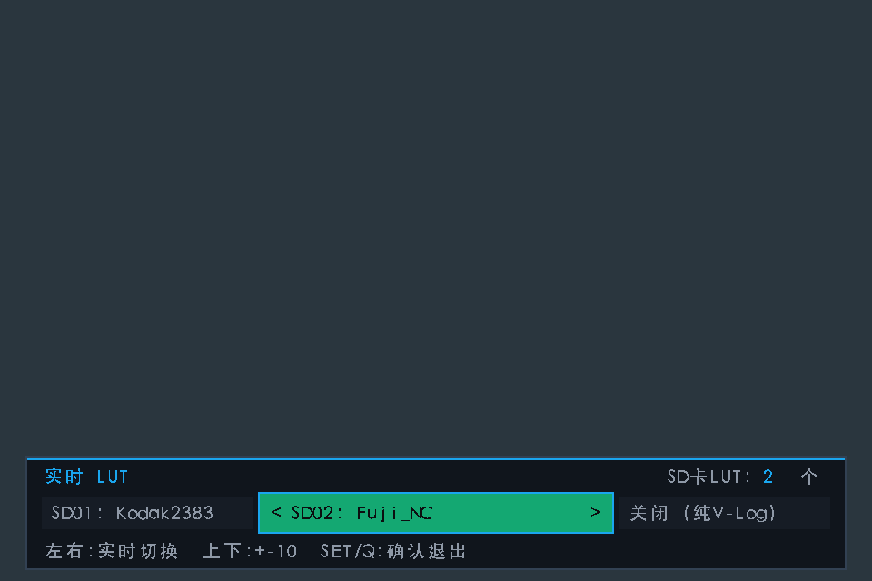

# Panasonic Lumix DC-S5 (V2.9 / MC801) 增强定制固件

面向松下 Lumix DC-S5 一代（固件 V2.9，`MC801`）的全功能定制增强固件工程，集成 **无时长限制高规格录制解锁**、**S5II 风格底部实时 LUT 快捷切换条**、**独立中文 OpenVG 自定义控制中心**、**SD 卡 100 个 `.CUBE` / `.VLT` 直读解析** 与 **极速 Direct-YCbCr 照片实时 LUT 直出**。




---

## 一、核心特性总览

1. **S5II 风格实时 LUT 快捷条 & 100 个 SD 卡 LUT 扩展（`03_program.bin` @ `0x07100000`）**
   - **一键呼出不挡取景**：接管原厂 `Fn → LUT 选择`（`0x0686A074`），按下绑定的 Fn 键即在取景画面底部弹出 `122px` 三卡片式转盘（`< SD02: Fuji_NC >`），保留上方 80% 实时取景视野；左右键实时切换，上下键 `±10` 快速翻页，再按一次 Fn 或 `SET` / `Q` 即收起。
   - **突破原厂 4 槽限制，支持 100 个 `.CUBE` / `.VLT`**：
     - **清单模式**：读取 `A:\LUT\LIST.TXT`（自动回退 `B:\LUT\LIST.TXT`），支持最多 100 个最长 43 字符的自定义文件名（兼容 UTF-8 BOM、行尾空白、`#` 注释）。
     - **零配置模式**：无 `LIST.TXT` 时自动扫描 `A:\LUT\001.CUBE`..`100.CUBE` 或 `001.VLT`..`100.VLT`，并自动提取 `TITLE "..."` 作为显示名。
     - **流式整数解析（零 FPU）**：兼容 `9³ / 17³ / 33³ / 65³` `.CUBE`（含 `LUT_1D_SIZE` 预曲线跳过、无尾换行冲洗）与 `17³` `0..4095` `.VLT`，实时重排进 `0x0710A200` 的 `0xBEEF` 八分体缓冲并同步刷新取景器/HDMI ISP 硬件 3D-LUT。
   - **全格调实时监看与所见即所得**：钩住 `0x066AE7C4` 并持久同步 `0x08CC576B/C`，在 `V-Log (0x0A/0x0B)`、`自定义照片格调 1..10 (0x1E..0x27)` 及“全部照片格调”模式下，屏幕取景与最终 JPEG 直出严格一致，半按快门不掉 LUT；切回 `关闭 (纯V-Log)` 时同时关闭监看与直出烘焙。

2. **独立中文 OpenVG 控制中心（`MENU → 设置 → 其他 → 控制中心`）**
   - `20_osdover.bin` 原位等字节替换 `像素更新` → `控制中心`（英文 `Pixel Refresh` → `ControlCenter`），点击即打开 7 行中文面板：
     1. `实时 LUT 槽位`（`关闭 (纯V-Log)` / 已导入机内槽位 / `SD01..SD100`）
     2. `LUT 快捷键`（`Fn: 实时选LUT` / `Fn: 打开面板` / `关闭 (原厂)`）
     3. `LUT 生效格调`（`仅V-Log/自定` / `全部照片格调`）
     4. `对焦提示音静音`（实时清零/恢复 `0x06E35134` 对焦滴声采样数）
     5. `菜单主题配色`（`青蓝` / `琥珀` / `翠绿`）
     6. `恢复默认设置`
     7. `保存配置并退出`（持久化写入 `A:\S5_CC.CFG`，断电重启后首次按键自动静默恢复）

3. **极速 Direct-YCbCr 9³ 照片实时 LUT 直出（`07_postboot3.bin` @ `0x879F7900`）**
   - 拦截 `0x877537A2` JPEG 编码前 NV16 描述符获取调用，采用直接 `YCbCr -> YCbCr` 9³ 四面体插值 + ARMv7 SWAR 双通道乘加融合，单像素仅 **~52.3 条指令**，覆盖全画幅 `3:2 / 4:3 / 16:9 / 1:1 / 65:24 XPan` 全部静态比例，缩略图与视频帧零开销旁路。
   - 配套修补 `0x866AE770` 回放防双重套 LUT。

4. **视频时长解除、13 项高规格 / ALL-I 解锁、300 Mbps 升码率与上下自由刷机（`patch_s5_video_unlim.py`）**
   - 解除 30 分钟录像时长上限（`0x868261B6`）；
   - 解锁 6K Open Gate、5.9K、5.4K OG、4K/C4K 400M 4:2:2 10-bit ALL-I、FHD 200M ALL-I 等 13 项安全规格；
   - 6K / 5.9K 码率由 200 Mbps 提升至 **300 Mbps**；
   - 解锁设置菜单版本按钮预检与 UPD 版本比较（`0x8681E9A2`、`0x8681E9DE`、`0x86867D12`），支持自由升级、同级重刷与降级回退原厂固件（完整保留 `MC801` 机型保护）；
   - 包含容器组件表直跳与全组件 SHA-256 + 外层 CRC32 完整性强校验补丁（`0x868C704E`、`0x868C70A4`）。

---

## 二、从 0 开始完整刷机教程（一张 SD 卡即可，含 S5 取消验签）

> ⚠️ **仅限松下 Lumix DC-S5 一代（机身代号 `MC801`），且当前机内固件为 V2.9。** 切勿刷入 S5II / S5IIX 或其他机型！

### 第 0 步：准备物品与文件
* **满电原厂电池**（建议 ≥ 80%）、**一根可传数据的 USB-C 线**、**一张 SD 卡**（只需一张卡即可）。
* 准备好以下文件：
  1. **RAM 取消验签软件**：[**LumiMod/s5-update-bypass**](https://github.com/LumiMod/s5-update-bypass)（[Release v0.1.0 直接下载](https://github.com/LumiMod/s5-update-bypass/releases/tag/v0.1.0)，含 macOS `S5UpdateBypass.app` 与 Windows `S5UpdateBypass.exe`）；
  2. **刷机包**（二选一，强烈推荐 **方式 A**）：
     - 方式 A（SD 卡热插拔底座）：`S5___V29_BASE_LOADER.bin` + `S5_MOD.BIN`
     - 方式 B（一体化整包）：`S5___V29_ALL_PATCHED.bin`
  3. **原厂官方 V2.9 固件**：`S5___V29.bin`（SHA-256 `b2ec4aeec209693b874df8dfdf11fc85b38fa4675b44ec554b7a167f430827e1`，用作救砖兜底）。

### 第 1 步：准备 SD 卡（单卡同时放刷机包 + 救砖包，互不冲突）
1. 用相机把 SD 卡格式化一遍，再插到电脑读卡器；
2. 将选定的刷机包（如 `S5___V29_BASE_LOADER.bin`）拷入 SD 卡根目录并重命名为 **`S5___V30.bin`**；
3. （推荐）同时把**原厂官方 `S5___V29.bin`** 拷入同一张 SD 卡根目录并重命名为 **`MC801.upd`** 作为救砖兜底（正常菜单更新只认 `S5___V30.bin`，通道 4 救砖只认 `MC801.upd`，两者同卡共存互不干扰；也可以不提前放，真需要救砖时再插电脑拷入）；
4. ⚠️ **首次刷方式 A 底座时，先不要放 `S5_MOD.BIN`**，等底座刷完正常开机后再拷入；
5. 安全弹出 SD 卡，插回相机卡槽 1（此时相机保持**关机**）。

### 第 2 步：首次刷机前提 —— 进服务模式用软件临时关闭 RAM 验签（0 变砖风险）
原厂 V2.9 固件会校验更新包的 ECDSA P-256 签名，**纯原厂机身无法直接刷入未签名的自打包固件**。首次刷机必须先关闭内存（RAM）中的验签开关：

1. 将机身**左肩驱动模式拨盘**拨到 **单拍** 档位；
2. 同时按住机身背面 **`AF-ON` + `PLAY（回放 ▶）`** 不松手，拨动电源开关开机，进入 **通道 3：USB 服务模式**，通电后松开按键；
3. 用 USB-C 线连接电脑，确认系统识别到松下服务模式设备 **`04DA:2370`**；
4. 打开 [**S5UpdateBypass**](https://github.com/LumiMod/s5-update-bypass/releases/tag/v0.1.0)（仓库：[LumiMod/s5-update-bypass](https://github.com/LumiMod/s5-update-bypass)；Windows 端首次需用 Zadig 将 `04DA:2370` 绑定为 WinUSB；macOS 首次被拦截可执行 `xattr -dr com.apple.quarantine /Applications/S5UpdateBypass.app`）：
   - 点击 **连接相机**，确认相机状态显示 **`已连接`**；
   - 查看状态栏确认 `layout = V2.9`、`code = 0xD021`、`switch = 0x0000`（对应物理地址 **`0x8631801A`**）；
   - 模式保持默认选中：**`彻底关闭（官方开关，ECDSA + SHA 都跳过）`**（`full` 模式，只写数据内存、不碰指令缓存，最稳；**完全不写 NAND，0 变砖风险**）；
   - 点击 **一键关闭验签** 并确认，待状态变为 **`full-skip`** 且读回 `switch = 0x0001`；
   - 点击 **断开**，拔掉相机 USB 线。
5. **⚠️ 关键：拔掉 USB 线后绝对不要关机或重启！** 保持当前开机状态直接进入第 3 步（原厂菜单更新 `0x0681E8EC` 会在当前运行态直接原地校验并写完 NAND 后才重启；一旦重启，RAM 里的开关会复位为 `0x0000`）。

### 第 3 步：直接刷入定制固件主包（约 1～2 分钟，真正写 NAND）
1. 保持第 2 步的开机状态（卡里已放好 `S5___V30.bin`）；
2. 按机身 **`MENU`** 键，进入 **`设置（扳手） → 其他 → 版本显示 → 固件更新`**（容器头已设为 `Ver. 3.0`，原厂 V2.9 会直接识别升级）；
3. 确认开始更新，**双手离开相机，刷写全程严禁断电、拔电池或拔 SD 卡**；
4. 等待约 1～2 分钟写完，相机会**自动重启**；确认能正常进入取景界面与菜单即刷机成功。
5. **仅此一次，以后永不再改 RAM**：本仓库的两个刷机包均已永久内置：
   - `0x068C704E`（`21d0 → 23e0`）与 `0x068C70A4`（`99f8 → f8e7`）：永久跳过 ECDSA 验签，同时**强制保留逐组件 SHA-256 与外层 CRC32 完整性校验**；
   - `0x06867D12`（`0bda → 00bf`）及菜单版本门控补丁：解除版本号限制，后续可直接通过菜单或通道 4 自由升级、同级重刷或降级回原厂固件（保留 `MC801` 机型保护）。

### 第 4 步：放上 `S5_MOD.BIN` 与自定义 LUT（方式 A 日常使用）
1. 刷机成功并确认开机正常后，将 SD 卡插回电脑，可删掉根目录的 `S5___V30.bin`（`MC801.upd` 也可按需删掉或留作备份）；
2. 将 **`S5_MOD.BIN`** 拷到 SD 卡根目录（`SD:\S5_MOD.BIN`，卡槽 1/2 均可）；
3. 在根目录新建 `LUT` 文件夹（`SD:\LUT\`）放入你的 `.cube` / `.vlt` 文件（详情见下文第六节）；
4. 插回相机开机，**随便按一下按键**（或进 `MENU → 设置 → 其他 → 控制中心`）即自动校验 CRC32 并热加载 `S5_MOD.BIN`；将任意顺手的 **`Fn` 键**绑定为原厂 **`LUT 选择`** 即可一键呼出底部实时 LUT 条。

---

## 三、应急救砖与工程模式速查（防变砖兜底）

### 1. 方式 A 物理零风险回退
拔掉 SD 卡或删除 SD 卡根目录的 `S5_MOD.BIN` 后重启，底座所有钩子自动回退至 100% 原厂固件行为。

### 2. 通道 4 早启动应急 SD 盲刷救砖（黑屏 / 死机 / 进不了菜单时使用）
若后续测试或刷机后无法进入系统菜单，可直接使用松下底层早启动盲刷通道救回（用同一张 SD 卡即可）：
1. 相机**关机**；确保 SD 卡根目录有**原厂官方 `S5___V29.bin`** 重命名而成的 **`MC801.upd`**（⚠️ 不要命名为 `MC801e.upd`，普通包会被 `0x06867D14` 拒绝；如之前未提前拷入，此时拔卡插电脑拷入即可），插在卡槽 1 或卡槽 2 均可。
2. 左肩驱动模式拨盘拨到 **自拍计时 ⏱** 档位。
3. 同时按住机身背面 **`AF-ON` + `PLAY（回放 ▶）`** 不松手，拨动电源开机，保持不动等待盲刷自动完成。

**安全边界说明**：
- 通道 4（`0x063C8BFE → 0x065451F2 → 0x063CA7A6`）在 `postboot` / `osdover` / GPU / Linux / UI 及全部 5 个自定义钩子加载**之前**运行，且 `min_ver = 0` 完全无视机身版本号；
- 本仓库所有刷机包对 `00_loader1` / `01_loader2` / `02_loader3` 及 `03_program` 入口到通道 4 之间的早启动代码均为 **0 字节修改**，因此任何功能/UI/postboot 故障均在通道 4 可救范围内；
- 机内已刷入本仓库底座或整包后，通道 4 同时兼容原厂 `MC801.upd` 与本仓库自打包（改名 `MC801.upd`）；
- **唯一不可救红线**：刷写 NAND 过程中突然断电/拔电池导致底层损坏，请务必保证电量充足且全程不触碰电源与卡槽。

### 3. S5 隐藏工程模式按键速查（供开发者 / AI 参考）
开机时按住 **`AF-ON`（`0x7F080420` / `0x2000`）+ `PLAY`（`0x7F080050` / `0x0400`）**，通过**左肩驱动模式拨盘**（`0x88E21132`）切换：

| 左肩驱动模式拨盘 | 触发模式 | 说明 |
| :--- | :--- | :--- |
| **单拍**（ADC `670 → 2`） | **通道 3：USB 服务模式**（`04DA:2370`） | 首次刷机改 RAM `0x8631801A = 1` 临时关验签入口 |
| **自拍计时 ⏱**（ADC `0 → 3`） | **通道 4：早启动应急 SD 盲刷救砖** | 自动扫描 `a:\` / `b:\` 下 `MC801.upd`，`min_ver = 0` 无视版本号 |
| **连拍 II**（ADC `319 → 7`） | **工厂调试标志**（`0x08AA96F4 = 1`） | 置位工厂调试标志 |

---

## 四、两种部署方式（强烈推荐方式 A：魔灯式 SD 卡热插拔）

### 方式 A：极简永固底座 + SD 卡热插拔模块（推荐！）
- **只需刷一次 NAND**：将 `S5___V29_BASE_LOADER.bin` 改名为 **`S5___V30.bin`** 拷入 SD 卡根目录刷入相机（容器版本头已升为 **`Ver. 3.0` (`0x0300`)**，可直接被已装 2.9 的机身识别升级；机内运行版本仍保留 `2.9` 并已解锁上下/同级自由刷机；机内仅驻留 `1,184 B` 引导器 + `80 B` 拍照桥接桩 + 6K/ALL-I/300M 基础解锁）。
- **日常升级只拷 SD 卡**：将 **`S5_MOD.BIN`**（仅 `31.1 KB`）拷到 SD 卡根目录（`A:\S5_MOD.BIN` 或 `B:\S5_MOD.BIN`，若卡槽 1 文件损坏会自动回退读取卡槽 2），开机首次按键或打开控制中心即自动校验 CRC32、同步 4 核 `ICIALLUIS` 指令缓存并热加载进 `0x07100000`（1 MB 专属空间）。
- **零变砖保障**：拔出 SD 卡或删除 `S5_MOD.BIN` 重启，所有钩子自动回退至 100% 原厂行为；文件损坏时 CRC32 自动拦截拒载。
- **底座与模块构建验证命令**：
  ```bash
  # RULES-ACTIVE-GLOBAL
  python3 tools/build_loader_and_mod.py --dec-dir ../s5_v29_decrypted
  python3 tools/verify_loader_and_mod.py
  python3 tools/pack_firmware.py --patch-dir ./build_loader --out-bin ./S5___V29_BASE_LOADER.bin --version-bcd 0x0300
  ```
- **校验值（容器头 `Ver. 3.0 / 0x0300`，内置上下/同级自由刷机补丁）**：
  - `S5___V29_BASE_LOADER.bin`（`90,238,464` bytes，Outer CRC32: `0x3ee75010`）：`369232e9fbca14b0e70dce4a8fa12bffcb4e1a3df944203bbfb7013dca702fea`
  - `S5_MOD.BIN`（`31,880` bytes，Payload CRC32: `0xf53178be`）：`17178455b57057b89d06c52332ca1dd0f6c9b759f66a4d80c43f7d26342b9362`

### 方式 B：一体化整包（免放 `S5_MOD.BIN`）
- 直接将 `S5___V29_ALL_PATCHED.bin` 改名为 **`S5___V30.bin`** 拷入 SD 卡根目录刷入（容器头同样已升为 `Ver. 3.0 / 0x0300`），全部功能直接内置于固件中。

---

## 五、仓库目录结构

```text
# RULES-ACTIVE-GLOBAL
lumix-s5-v29-firmware/
├── S5___V29_BASE_LOADER.bin           # 方式 A：极简永固底座刷机包 (90,238,464 B, V3.0 容器头)
├── S5_MOD.BIN                         # 方式 A：SD 卡热插拔功能模块 (31,880 B, 带 CRC32)
├── S5___V29_ALL_PATCHED.bin           # 方式 B：一体化全功能刷机包 (90,238,464 B, V3.0 容器头)
├── loader/
│   ├── s5_mod_abi.h                   # 底座与 SD 模块共享 ABI 及内存映射定义
│   ├── s5_loader.c                    # 1,184 B 常驻 SD 模块热加载器 (0x070F8000)
│   └── pb3_stub.c                     # 80 B 跨地址域 JPEG 桥接桩 (0x879F7900)
├── mod/
│   └── s5_mod_main.c                  # S5_MOD.BIN 模块入口与钩子注册表
├── src/
│   ├── control_center.c               # 中文控制中心 + S5II 实时 LUT 快捷条 + SD .CUBE/.VLT 加载器
│   ├── cc_font_zh.h                   # 内嵌点阵中文字模表
│   ├── hook.c                         # Direct-YCbCr 9^3 四面体 JPEG 实时 LUT 烘焙内核
│   └── lut_tables.h                   # 0xBEEF 八分体反映射表
├── tools/
│   ├── patch_s5_video_unlim.py        # 视频时长/规格/码率/回放 LUT/自由刷机基础补丁器
│   ├── build_loader_and_mod.py        # 编译方式 A 永固底座与 SD 卡 S5_MOD.BIN
│   ├── verify_loader_and_mod.py       # Unicorn ARM 分离式底座与双卡回退全场景验证
│   ├── build_combined.py              # 编译方式 B 一体化载荷 (03_program / 07_postboot3 / 20_osdover)
│   ├── verify_combined.py             # Unicorn ARM 一体化回归测试（8 大用例 + 渲染预览图）
│   ├── pack_firmware.py               # AES-5 固件打包 + SHA-256 表更新 + 逐字节白名单往返比对
│   ├── run_qemu_patched.py            # 4 核 ARMv7 QEMU RTOS 冷启动实测脚本
│   ├── gen_lut_tables.py              # 八分体查表生成工具
│   ├── gen_zh_font.py                 # 中文字库头文件生成工具
│   └── panasonic-aes5                 # 固件组件加解密工具
├── prebuilt/                          # 预编译载荷与组件构建清单 JSON
└── assets/                            # UI 与 QEMU 渲染实测截图
```

---

## 六、SD 卡目录放置说明

1. **刷机包放置**：将 `S5___V29_BASE_LOADER.bin` 或 `S5___V29_ALL_PATCHED.bin` 拷入相机格式化好的 SD 卡根目录并重命名为 **`S5___V30.bin`**（因容器头已升版至 `Ver. 3.0`，已安装 V2.9 的机身会直接识别为新版本）。
2. **自定义 100 个 LUT 放置**（插在卡槽 1 `A:` 或卡槽 2 `B:` 均可）：
   - 在 SD 卡根目录新建 `LUT` 文件夹（例如 `SD:\LUT\`）；
   - **方式一（推荐，保留原始名字）**：放入任意 `.cube` / `.vlt` 文件，并新建文本文件 `SD:\LUT\LIST.TXT`，每行写一个文件名（最多 100 行）：
     ```text
     # RULES-ACTIVE-GLOBAL
     Kodak_2383_D65.cube
     Fuji_ClassicNeg.vlt
     Arri_LogC_709.cube
     ```
   - **方式二（免清单）**：按 `001.CUBE`、`002.VLT` … `100.CUBE` 命名放入 `SD:\LUT\`，固件会自动读取文件内 `TITLE` 显示名称。
3. **快捷键绑定**：进入相机原生菜单把任意顺手的机身 Fn 键设为原厂 **`LUT 选择`**，取景时按下该 Fn 键即可直接呼出底部实时 LUT 切换条。

---

## 七、复现构建、仿真验证与打包命令

```bash
# RULES-ACTIVE-GLOBAL
# 1. 编译 ARMv7 载荷并构建 03_program.bin / 07_postboot3.bin / 20_osdover.bin
python3 tools/build_combined.py --dec-dir ../s5_v29_decrypted --out-dir ./build

# 2. 运行 Unicorn ARM 全链路回归测试（8 组硬件与边界测试）
python3 tools/verify_combined.py --build-dir ./build

# 3. 加密打包 S5___V29_ALL_PATCHED.bin 并执行往返解密 + SHA-256 校验
python3 tools/pack_firmware.py --patch-dir ./build --out-bin ./S5___V29_ALL_PATCHED.bin

# 4. 运行 4 核 QEMU RTOS 冷启动验证（需本地配好 s5-emulator）
python3 tools/run_qemu_patched.py --patched-dir ./build
```

---

## 八、一体化整包校验值（SHA-256 & CRC32）

- **`S5___V29_ALL_PATCHED.bin`**（`90,238,464` bytes，容器头 `V3.0 / 0x0300`，Outer CRC32: `0x99227977`）：
  `b48836561aaa7b22e3a5b599b0a0fe535aadde1a08ba9eb3787470a3993491e5`
- **`03_program.bin`**（一体化）：
  `58052df5096cdddbbef06b4bc38b66e65ce1add910969dc54b03dacfef3473ca`
- **`07_postboot3.bin`**（一体化）：
  `9f2691c2e911e608432f7f892273bb792f60dba7fee610fa4d9809eaa0ed5b18`
- **`20_osdover.bin`**：
  `2181c40dd01ad78cca584a64c2292dcb9f57121d9340fcc963bbf33b276af843`
